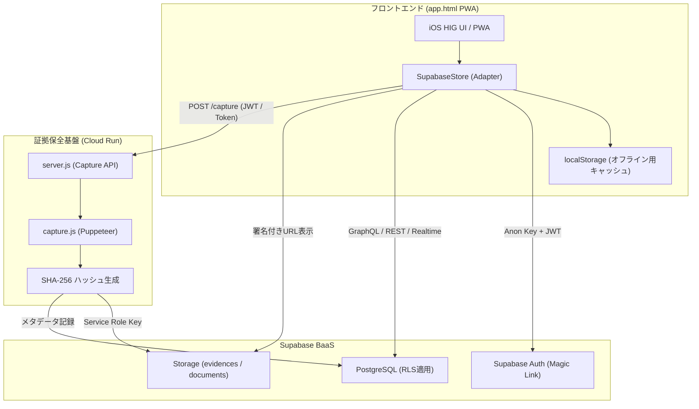

# Supabase 認証基盤 & 接続インターフェース設計書

**プロジェクト名**: 開示請求管理＆魚拓証拠保全スイート（kaiji-gyotaku）  
**バージョン**: 1.0.0  

---

## 1. 全体アーキテクチャ概要



---

## 2. ユーザー認証 & オンボーディング設計

### 2.1 認証方式（Magic Link 推奨）
弁護士や多忙な依頼者にとって、「パスワード管理・複雑な要件」は離脱や誤操作の原因となります。
- **Magic Link（メールワンクリックログイン）** を主方式として採用。
- モバイルPWA・PCブラウザの双方で、メール内リンクをクリックするだけでセキュアにログイン完了。
- オプションとして、開発・即時検証用の Email/Password 方式も併用可能。

### 2.2 ロールと招待フロー
1. **依頼者（Owner/Client）**:
   - 自身の事案ワークスペースを作成。
   - 発信者の登録、投稿の追加、魚拓撮影を実行。
2. **弁護士（Lawyer）の招待**:
   - 依頼者がアプリ内「弁護士情報」画面から弁護士のメールアドレスを入力して招待を送信。
   - 弁護士には専用の参加リンク（Magic Link + Workspace招待トークン）が届く。
   - 弁護士がログインすると、対象ワークスペースの閲覧・リアクション（「あり！」「うーん…」）・書類依頼・進捗更新権限が付与される。

---

## 3. クライアント側（PWA）インターフェース設計

既存の `app.html` / `app-v8.html` は `Store.load()` / `Store.save(data)` という単一の同期オブジェクトで設計されています。
これを段階的に非同期・Supabase連携へと移行するための **`SupabaseStore` アダプター** を導入します。

### 3.1 アダプターのシグネチャ

```typescript
interface DataStore {
  // 初期化・セッション復元
  init(): Promise<{ session: any; user: any }>;
  
  // 認証
  signInWithOtp(email: string): Promise<{ error: any }>;
  signOut(): Promise<void>;
  
  // 事案（Cases）
  getCases(workspaceId: string): Promise<Case[]>;
  saveCase(caseData: Partial<Case>): Promise<Case>;
  updateStep(caseId: string, nextStep: number): Promise<void>;
  setReaction(caseId: string, reactionKey: string): Promise<void>;

  // 発信者（Senders）
  getSenders(workspaceId: string): Promise<Sender[]>;
  saveSender(senderData: Partial<Sender>): Promise<Sender>;

  // 本名（Persons）
  getPersons(workspaceId: string): Promise<Person[]>;
  savePerson(personData: Partial<Person>): Promise<Person>;

  // 証拠保全キャプチャ
  captureUrl(url: string, caseId?: string): Promise<EvidenceResult>;
}
```

### 3.2 キャッシュ & オフライン耐性
- 取得したDBデータは `localStorage` にミラーリング。
- 電波の不安定な裁判所内や移動中のスマホでも閲覧可能。
- オンライン復帰時に未送信メッセージやステータス更新を同期。

---

## 4. バックエンド（Cloud Run）キャプチャ連携の刷新

現行の `server.js` はPNG画像をHTTPレスポンスでクライアントに直接バイナリ返却していますが、これを **「Storage直接アップロード ＋ SHA-256メタデータ記録」** に昇格させます。

### 4.1 キャプチャ処理フロー (`POST /api/capture`)

```javascript
// 処理フロー
1. クライアントから URL と (任意) case_id を受領
2. Puppeteer で撮影、帯付き PNG を生成
3. PNG バイナリから SHA-256 ハッシュを計算:
   const sha256 = crypto.createHash('sha256').update(pngBuffer).digest('hex');
4. Supabase Storage にアップロード:
   const storagePath = `workspaces/${workspaceId}/evidences/${sha256}.png`;
   await supabaseAdmin.storage.from('evidences').upload(storagePath, pngBuffer, {
     contentType: 'image/png',
     upsert: false // 既存改ざん禁止
   });
5. DB `evidences` テーブルにレコード挿入:
   await supabaseAdmin.from('evidences').insert({
     case_id: caseId,
     storage_path: storagePath,
     file_name: `evidence_${postNo || sha256.slice(0, 8)}.png`,
     file_size: pngBuffer.length,
     sha256_hash: sha256,
     captured_at: capturedAt,
     target_url: url,
     normalized_url: normalizedUrl,
     capture_mode: mode
   });
6. レスポンス: { ok: true, sha256, storagePath, publicUrl: ... }
```

### 4.2 改ざん防止・証拠能力向上の仕組み
- ハッシュ値 `sha256` はファイル内容から一意に決定されるため、後から1ピクセルでも書き換えられれば不一致となります。
- DBの `evidences.captured_at` とPNG帯内の印字日時、HTTPヘッダーの3重検証が可能となり、裁判官・相手方弁護士への証拠提出時に絶大な信用性を持ちます。

---

## 5. 環境変数・シークレット構成

### Cloud Run（バックエンド）
- `PORT`: `8080`
- `SUPABASE_URL`: `https://<project-ref>.supabase.co`
- `SUPABASE_SERVICE_ROLE_KEY`: `eyJhbGciOi...`（特権キー：Storage保存 & DB記録用）
- `CAPTURE_TOKEN`: （既存のBearerトークン互換。認証移行完了まで維持）

### PWA クライアント（フロントエンド）
- `SUPABASE_URL`: `https://<project-ref>.supabase.co`
- `SUPABASE_ANON_KEY`: `eyJhbGciOi...`（公開キー：RLSによってアクセス保護）
