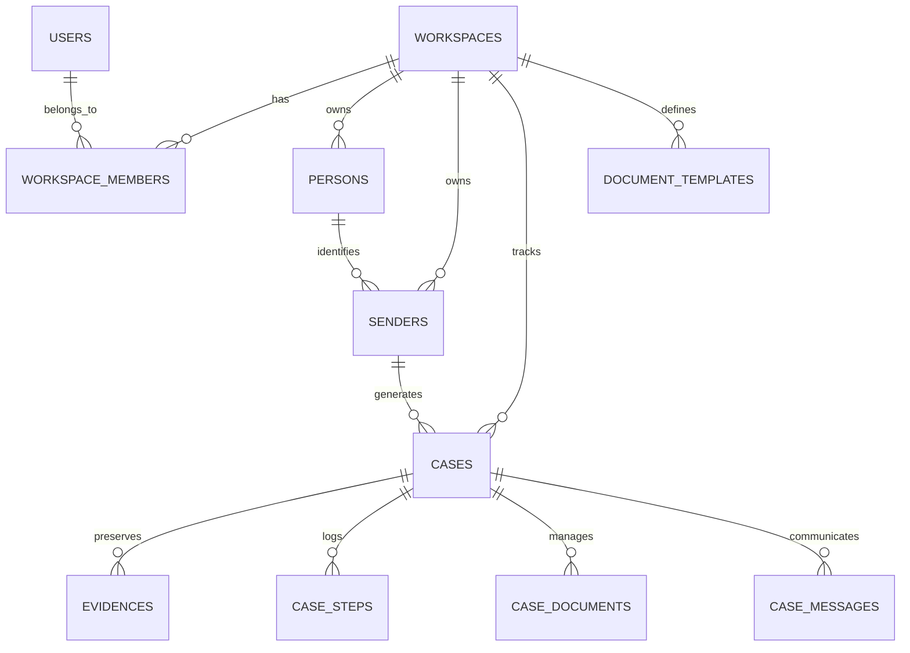

# データベーススキーマ設計書 (Supabase / PostgreSQL)

**プロジェクト名**: 開示請求管理＆魚拓証拠保全スイート（kaiji-gyotaku）  
**バージョン**: 1.0.0  
**設計方針**:
- **フェーズ1（プライベート）**: 依頼者（自分）と担当弁護士によるクローズド・コラボレーション
- **将来SaaS拡張性**: すべての主要テーブルに `workspace_id`（テナントID）を保持し、コードやDB構造を壊さずにマルチテナントSaaSへ即移行可能とする。
- **証拠保全の法的完全性**: 魚拓画像（PNG）のSHA-256ハッシュ、撮影日時、タイムゾーン、正規化URL、撮影モードを不可変記録。

---

## 1. ER図・リレーション概要



---

## 2. テーブル定義書

### 2.1 テナント & 認証基盤

#### `workspaces` (ワークスペース / 将来のテナント)
| カラム名 | 型 | 制約 | 説明 |
| :--- | :--- | :--- | :--- |
| `id` | `uuid` | PK, default `gen_random_uuid()` | ワークスペースID |
| `name` | `text` | NOT NULL | ワークスペース名（例: 「山田開示請求事案」） |
| `lawyer_office` | `text` | NULL | 担当法律事務所名 |
| `lawyer_name` | `text` | NULL | 担当弁護士氏名 |
| `lawyer_tel` | `text` | NULL | 連絡先電話番号 |
| `lawyer_email` | `text` | NULL | 弁護士メールアドレス |
| `created_at` | `timestamptz` | NOT NULL, default `now()` | 作成日時 |
| `updated_at` | `timestamptz` | NOT NULL, default `now()` | 更新日時 |

#### `workspace_members` (メンバーシップ & ロール管理)
| カラム名 | 型 | 制約 | 説明 |
| :--- | :--- | :--- | :--- |
| `id` | `uuid` | PK, default `gen_random_uuid()` | メンバーID |
| `workspace_id` | `uuid` | FK -> `workspaces(id)` ON DELETE CASCADE | 所属ワークスペース |
| `user_id` | `uuid` | FK -> `auth.users(id)` ON DELETE CASCADE | Supabase Auth ユーザーID |
| `role` | `text` | NOT NULL, CHECK in (`owner`, `client`, `lawyer`, `viewer`) | 権限ロール |
| `display_name` | `text` | NOT NULL | 表示名（例: 依頼者、担当弁護士） |
| `created_at` | `timestamptz` | NOT NULL, default `now()` | 参加日時 |

---

### 2.2 本名・発信者管理

#### `persons` (特定された人物・本名情報)
示談金や本人連絡先、住所など極めてセンシティブな個人情報を集約。
| カラム名 | 型 | 制約 | 説明 |
| :--- | :--- | :--- | :--- |
| `id` | `uuid` | PK, default `gen_random_uuid()` | 人物ID |
| `workspace_id` | `uuid` | FK -> `workspaces(id)` ON DELETE CASCADE | ワークスペースID |
| `name` | `text` | NOT NULL | 本名（例: 「山田 太郎」） |
| `address` | `text` | NULL | 判明住所 |
| `tel` | `text` | NULL | 判明電話番号 |
| `contact_memo` | `text` | NULL | 示談状況・代理人の有無等 |
| `settlement_amount` | `integer` | DEFAULT 0 | 示談合意金額（円） |
| `payment_due` | `date` | NULL | 振込期日 |
| `payment_done_at` | `date` | NULL | 振込確認日 |
| `created_at` | `timestamptz` | NOT NULL, default `now()` | 登録日時 |
| `updated_at` | `timestamptz` | NOT NULL, default `now()` | 更新日時 |

#### `senders` (SNS/掲示板アカウント・発信者)
| カラム名 | 型 | 制約 | 説明 |
| :--- | :--- | :--- | :--- |
| `id` | `uuid` | PK, default `gen_random_uuid()` | 発信者ID |
| `workspace_id` | `uuid` | FK -> `workspaces(id)` ON DELETE CASCADE | ワークスペースID |
| `sender_no` | `text` | NOT NULL | 発信者管理番号（例: `260901`） |
| `name` | `text` | NOT NULL | アカウント名/表示名（例: 「サンプル太郎」） |
| `site` | `text` | NOT NULL | プラットフォーム（`X`, `5ch`, `爆サイ`, `その他`） |
| `handle` | `text` | NULL | ハンドル名・ID（例: `@sample_user01`, `>>88`） |
| `profile_url` | `text` | NULL | プロフィールURL |
| `person_id` | `uuid` | FK -> `persons(id)` ON DELETE SET NULL | 特定された本名レコードへの紐付け |
| `created_at` | `timestamptz` | NOT NULL, default `now()` | 登録日時 |
| `updated_at` | `timestamptz` | NOT NULL, default `now()` | 更新日時 |

---

### 2.3 投稿事案 & 証拠保全（核となるテーブル）

#### `cases` (投稿事案・開示手続ケース)
| カラム名 | 型 | 制約 | 説明 |
| :--- | :--- | :--- | :--- |
| `id` | `uuid` | PK, default `gen_random_uuid()` | 事案UUID |
| `workspace_id` | `uuid` | FK -> `workspaces(id)` ON DELETE CASCADE | ワークスペースID |
| `case_display_id`| `text` | NOT NULL | 表示用ID（例: `#01`） |
| `post_no` | `text` | NOT NULL | 投稿整理番号（例: `26090201`） |
| `sender_id` | `uuid` | FK -> `senders(id)` ON DELETE RESTRICT | 発信者 |
| `posted_at` | `timestamptz` | NULL | 投稿日時（X IDから算出または手動入力） |
| `content_text` | `text` | NOT NULL | 投稿本文・発言内容 |
| `crimes` | `text[]` | DEFAULT '{}' | 侵害類型（名誉毀損, 侮辱, 脅迫など） |
| `target_url` | `text` | NOT NULL | 対象URL（正規化済み） |
| `url_deleted` | `boolean` | DEFAULT false | 投稿が削除されているか |
| `step` | `integer` | NOT NULL, DEFAULT 1 | 現在の進捗ステップ番号（1〜12） |
| `branch_code` | `integer` | NULL | 分岐・行き止まりコード（例: 1, 5, 8, 9, 10） |
| `is_closed` | `boolean` | DEFAULT false | 事案完了/行き止まりフラグ |
| `filing_type` | `text` | NULL | 申立種別（発信者情報開示命令＋仮処分 / 発信者情報開示命令） |
| `schedule_label` | `text` | NULL | 期日名（例: 「ウェブ期日」「審尋期日」） |
| `schedule_date` | `date` | NULL | 期日日 |
| `reaction_stamp` | `text` | NULL | 弁護士リアクション（`good`, `hmm`, `meh`） |
| `reaction_at` | `timestamptz` | NULL | リアクション付与日時 |
| `memo` | `text` | NULL | 内部メモ・調査特記 |
| `created_at` | `timestamptz` | NOT NULL, default `now()` | 登録日時 |
| `updated_at` | `timestamptz` | NOT NULL, default `now()` | 更新日時 |

#### `evidences` (証拠保全・魚拓メタデータ)
訴訟法上の証拠能力を最大化するため、バイナリの完全性ハッシュを記録。
| カラム名 | 型 | 制約 | 説明 |
| :--- | :--- | :--- | :--- |
| `id` | `uuid` | PK, default `gen_random_uuid()` | 証拠保全ID |
| `case_id` | `uuid` | FK -> `cases(id)` ON DELETE CASCADE | 紐づく投稿事案 |
| `storage_path` | `text` | NOT NULL | Supabase Storage上の格納パス |
| `file_name` | `text` | NOT NULL | ファイル名（例: `evidence_26081001.png`） |
| `file_size` | `bigint` | NOT NULL | ファイルサイズ（バイト） |
| `mime_type` | `text` | NOT NULL, DEFAULT `'image/png'` | MIMEタイプ |
| `sha256_hash` | `text` | NOT NULL | SHA-256 チェックサム（改ざん防止検証用） |
| `captured_at` | `timestamptz` | NOT NULL | 撮影日時（帯に印字された正確な時刻） |
| `target_url` | `text` | NOT NULL | 撮影した元URL |
| `normalized_url`| `text` | NOT NULL | クエリ除去等を行った正規化URL |
| `capture_mode` | `text` | NOT NULL | 撮影方式（`post`: 記事指定, `page`: 全体） |
| `image_width` | `integer` | NULL | 画像幅 (px) |
| `image_height` | `integer` | NULL | 画像高 (px) |
| `created_at` | `timestamptz` | NOT NULL, default `now()` | レコード作成日時 |

---

### 2.4 手続履歴 & 書類 & コミュニケーション

#### `case_step_histories` (進捗履歴)
| カラム名 | 型 | 制約 | 説明 |
| :--- | :--- | :--- | :--- |
| `id` | `uuid` | PK, default `gen_random_uuid()` | 履歴ID |
| `case_id` | `uuid` | FK -> `cases(id)` ON DELETE CASCADE | 事案ID |
| `step_no` | `integer` | NOT NULL | ステップ番号（1〜12） |
| `reached_date` | `date` | NOT NULL | 到達日 |
| `updated_by` | `uuid` | FK -> `auth.users(id)` | 操作ユーザー |
| `note` | `text` | NULL | 補足メモ |
| `created_at` | `timestamptz` | NOT NULL, default `now()` | 記録日時 |

#### `document_templates` (書類テンプレート/フォーマット)
| カラム名 | 型 | 制約 | 説明 |
| :--- | :--- | :--- | :--- |
| `id` | `uuid` | PK, default `gen_random_uuid()` | テンプレートID |
| `workspace_id` | `uuid` | FK -> `workspaces(id)` ON DELETE CASCADE | ワークスペースID |
| `code` | `text` | NOT NULL | 書類コード（`01`, `02`等） |
| `name` | `text` | NOT NULL | 書類名（例: 「訴訟委任状（X開示用）」） |
| `version` | `integer` | NOT NULL, DEFAULT 1 | フォーマット版数 |
| `scope_type` | `text` | NOT NULL | 依頼範囲（`日付`, `名前`, `日付＋署名＋押印`） |
| `note` | `text` | NULL | 注意事項・説明 |
| `package_tags` | `text[]` | DEFAULT '{}' | セット種別（`x`, `bbs`, `settle`） |

#### `case_documents` (事案ごとの必要書類ステータス)
| カラム名 | 型 | 制約 | 説明 |
| :--- | :--- | :--- | :--- |
| `id` | `uuid` | PK, default `gen_random_uuid()` | 書類状態ID |
| `case_id` | `uuid` | FK -> `cases(id)` ON DELETE CASCADE | 事案ID |
| `template_id` | `uuid` | FK -> `document_templates(id)` | テンプレート参照 |
| `name` | `text` | NOT NULL | 書類表示名 |
| `status` | `text` | NOT NULL | 状態（`記入待ち`, `提出済`, `完了`） |
| `file_url` | `text` | NULL | アップロードされたスキャンPDF等のURL |
| `updated_at` | `timestamptz` | NOT NULL, default `now()` | 更新日時 |

#### `case_messages` (事案ごとのやり取りチャット)
| カラム名 | 型 | 制約 | 説明 |
| :--- | :--- | :--- | :--- |
| `id` | `uuid` | PK, default `gen_random_uuid()` | メッセージID |
| `case_id` | `uuid` | FK -> `cases(id)` ON DELETE CASCADE | 事案ID |
| `sender_id` | `uuid` | FK -> `auth.users(id)` | 発言ユーザーID |
| `sender_role` | `text` | NOT NULL | `client`（依頼者）または `lawyer`（弁護士） |
| `message` | `text` | NOT NULL | 本文 |
| `read_by_lawyer`| `boolean`| DEFAULT false | 弁護士側既読 |
| `read_by_client`| `boolean`| DEFAULT false | 依頼者側既読 |
| `created_at` | `timestamptz` | NOT NULL, default `now()` | 送信日時 |

---

## 3. Row Level Security (RLS) 設計

Supabase の RLS を用いることで、API層のバグによる他者データ流出をDBエンジンレベルで完全に防ぎます。

### 基本ポリシー
1. **ユーザーは自分が所属する `workspace` のデータにのみアクセス可能**
   ```sql
   -- 共通ヘルパー関数: 現在のユーザーが所属する workspace_id 一覧を取得
   CREATE OR REPLACE FUNCTION get_user_workspace_ids()
   RETURNS SETOF uuid AS $$
     SELECT workspace_id FROM workspace_members WHERE user_id = auth.uid()
   $$ LANGUAGE sql SECURITY DEFINER STABLE;
   ```

2. **テーブルごとの制御**:
   - `cases`, `senders`, `evidences`, `case_documents`, `case_messages`:
     - SELECT / INSERT / UPDATE: `workspace_id IN (SELECT get_user_workspace_ids())`
   - `persons`（示談金・住所・本名）:
     - 依頼者（`role IN ('owner', 'client')`）および弁護士（`role = 'lawyer'`）のみアクセス許可。一般閲覧者（`viewer`）はアクセス遮断。

---

## 4. Supabase Storage バケット設計

### バケット名: `evidences` (証拠保全PNG)
- **公開設定**: Private（署名付きURLまたはRLS認証付きURLで取得）
- **オブジェクトパス設計**:
  `workspaces/{workspace_id}/cases/{case_id}/{sha256_hash}.png`
- **セキュリティポリシー**:
  - `SELECT`: 所属メンバーのみダウンロード可能
  - `INSERT`: 所属メンバーまたは Cloud Run キャプチャサービス（Service Role Key）のみアップロード可能
  - `UPDATE / DELETE`: 原則不可（証拠改ざん防止のため不変オブジェクトとして扱う）

### バケット名: `documents` (PDF・書面スキャン等)
- **公開設定**: Private
- **オブジェクトパス設計**:
  `workspaces/{workspace_id}/cases/{case_id}/docs/{document_id}.pdf`
